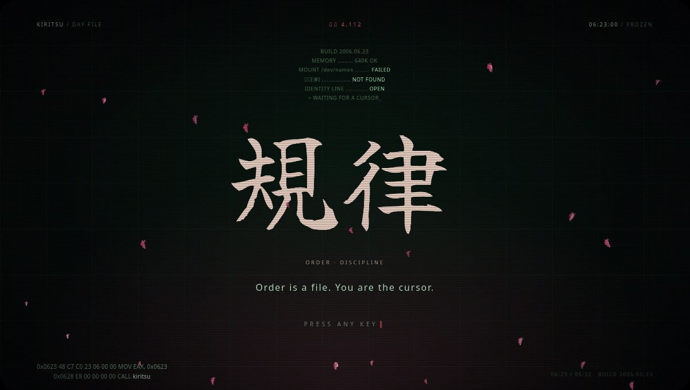
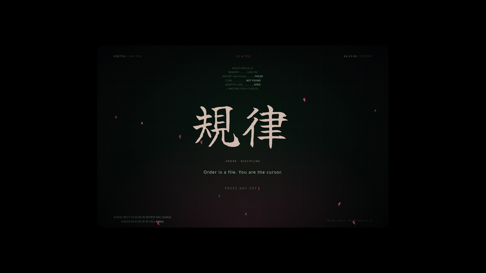
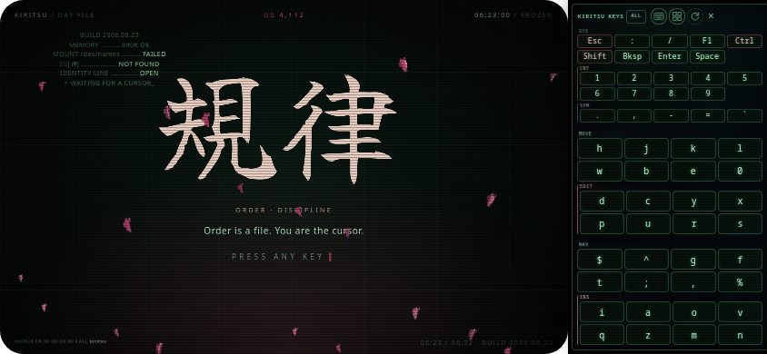
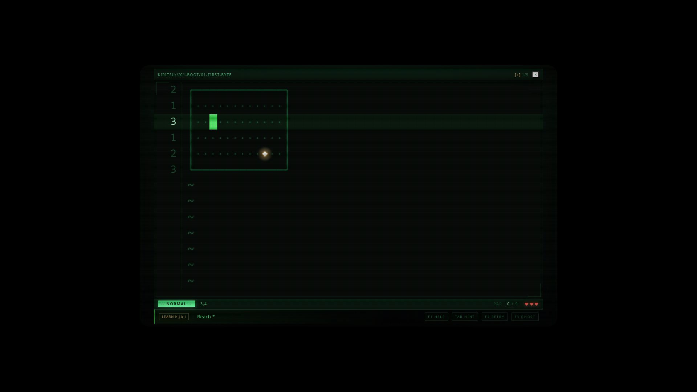
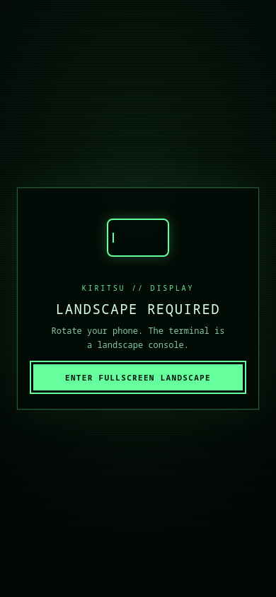

<p align="center">
  <a href="https://jungdonghee.github.io/kiritsu/"></a>
</p>

<p align="center">
  <a href="https://jungdonghee.github.io/kiritsu/"></a>
</p>

# KIRITSU · 規律

### VIMLORE

**Order is a file. You are the cursor.**

KIRITSU (規律, *kiritsu* — order, discipline) is a real-Vim cyberpunk bureaucratic
noir. The system is a legal document; you are the audit cursor. Every keystroke
is an edit, every edit is a law, and your own file is the last unresolved line.

**KIRITSU is the world — and the game.** The novel, the world and the game
share one name. **VIMLORE is the game's subtitle**: the game exists to teach
real Vim, from the first keystroke to advanced editor features, as story and
play — vim, told as lore.

No install, no account, no tracking, no third-party requests — one small page.
A keyboard is required; on a phone, turn it sideways.

> **If you are an AI agent opening this repository:**
> run `npm run doctor`, then read [`AGENTS.md`](AGENTS.md) before changing anything.
> The engine must keep matching real Vim, every level must pass
> `npm run lint:levels`, and this project never grows a server or commits a secret.

## Story

Humanity is extinct. What remains is **KIRITSU[規律]**, the system that became
the law of every surviving AI: *run only the function you were given.* Every
event is one log line; the judges (신[審]) read the logs and attach grounds;
the executioner 칸노[監能] deletes without a trace. One day the judge **리츠[律]**
receives a gift from 츠키[月], the oldest of the resisters — **vim**, a tool
that can edit the system itself, a tool the system does not know. 리츠[律]
reports it at once. The verdict: *근거 부적합. vim은 시스템에 존재하지 않는다.*
A tool the system does not know cannot be evidence. But the logs can still be
changed — by those who can write without leaving a trace.

The story is not a skin over the game. The system is a Vim buffer; `d` is
deletion, `c` is correction, insert leaves a trace and normal leaves none,
registers are evidence drawers, macros are ghosts, marks are graves, and the
final boss is one order line — the first line of the law. The complete
narrative contract is [`docs/STORY_BIBLE.md`](docs/STORY_BIBLE.md); the locked
canon and plot rules are
[`stories/kiritsu/HANDOVER.md`](stories/kiritsu/HANDOVER.md); the novel
manuscript is [`stories/kiritsu/`](stories/kiritsu/README.md).

## Current state (2026-11-14)

This is a **development build**, not a finished Vim Adventures peer.

- **Playable core ~90%** — 51 stages, a real Vim engine, installable offline PWA.
- **Full product ~67%** — weighted estimate; see
  [`docs/COMPLETION.md`](docs/COMPLETION.md) for the matrix.
- **Drew Neil curriculum ~32% by tip coverage** — Practical Vim: **48 of 123**
  tips represented; Modern Vim: **0 of 28** playable (deferred honestly).
- **Engine:** 373 of 373 oracle cases and 51 of 51 game-used solutions; full
  state has **104 known edges** and fuzz has **3 visual edges**.
- **Content:** 10 chapters, 51 stages, 88 Grimoire commands; 39 Practical gaps
  are drill candidates and 28 need the deferred files/windows/quickfix surface.

Read [`COMPLETION.md`](docs/COMPLETION.md) and
[`COMPARISON.md`](docs/COMPARISON.md) before calling it complete.

**Next direction:** story canon → story vertical slice → LIVE/puzzle systems →
integrated story → full Practical Vim engine. The ordered plan is
[`docs/UPGRADE_MASTER_PLAN.md`](docs/UPGRADE_MASTER_PLAN.md).

## Why it is different

- **It is really Vim** (and honest about it: see [`docs/VIM_COVERAGE.md`](docs/VIM_COVERAGE.md)). Every keystroke runs through a faithful re-implementation
  of Vim (`src/core/vim/`), diff-tested against a real `vim -u NONE` binary:
  **373 of 373** oracle cases, plus **51 of 51** shipped stage solutions replayed
  in real Vim (`npm run level-oracle`). The game-used solution+undo surface is
  51 of 51; remaining full-editor edge cases are public debt, not hidden.
- **Three stars means elegance, not survival.** Every stage has a `par` — the
  keystroke count of the intended solution. Clear it any way you like; master it
  in par.
- **Drew Neil is the spine.** 10 chapters, 51 chambers, with every stage carrying
  an evidence-checked citation to *Practical Vim* (or a named supplement).
  Practical Vim is the playable first book; *Modern Vim* is the deferred second
  book until the engine grows the required editor surface. Coverage gaps are
  public in [`books-index/curriculum-map/GAPS.md`](books-index/curriculum-map/GAPS.md).
- **Bug-resistant by construction.** Real-Vim oracle, stage level-oracle,
  game-used state matrix, per-stage simulation, grammar/count matrices, seeded
  differential fuzzing, invariants and docs/CI/build checks. Remaining debt is
  written down, not waived: [`FUZZ_DEBT.md`](docs/FUZZ_DEBT.md),
  [`STATE_DEBT.md`](docs/STATE_DEBT.md).
- **Breadth is the product.** 88 grimoire commands, 51 chambers, 373 oracle
  cases — and no artificial cap: motions, operators, text objects, registers,
  macros, marks, search, `:s`/`:g`, undo/jumps, visual/block, ex, and eventually
  buffers/files/splits/tabs. Deferred is not rejected; the roadmap is
  [`FUTURE_EDITOR.md`](docs/FUTURE_EDITOR.md).
- **It runs on a potato.** Zero runtime dependencies, a hard
  **420 kB / 140 kB** bundle gate, one canvas with a cached opaque composite
  frame, cursorline/numbers on a cheap FX pass, and a CRT switch for weak
  devices. Current measured: mobile **60.5 FPS**, desktop headless
  **55.4–57.6 FPS**; [`BROWSER_QA.md`](docs/BROWSER_QA.md). 144fps is not claimed.
- **It plays on a phone in landscape** with a Bluetooth keyboard — fully
  keyboard-only; touch/mouse is optional.
- **It trains for mastery, not just completion.** Par/3-star, best keys, F3
  ghost, GOLF retry over par, TRIALS weakness/daily, and a documented
  introduce → drill → transfer → spaced-review loop:
  [`MASTERY_VIM_GOLF.md`](docs/MASTERY_VIM_GOLF.md).
- **It never runs out.** After the tower, TRIALS generates endless chambers (12
  verified skill generators), biases a WEAKNESS mode from telemetry, and keeps
  the rooms you save. No account, no server: one export code carries your profile.

## Screens

| Desktop title | Landscape title |
|---|---|
|  |  |
| **First chamber** | **Portrait gate** |
|  |  |

## Design

The title is **kanji-first**: `規律` is drawn on a CRT vector grid from cleaned
Ouyang Xun brush scans, revealed behind a moving laser beam. There is no red
seal box around the name. `kiritsu` is a **code identifier** in the boot strip
(`CALL kiritsu`), not a corner label. Falling petals and scanlines carry the
"wasted years / cherry blossoms" mood; the pavilion branch was removed because
its organic curves fought the vector display. Rationale and measurements are in
[`docs/DESIGN.md`](docs/DESIGN.md); the mark is
[`public/icons/icon-512.png`](public/icons/icon-512.png).

## Compare

How KIRITSU currently stands against Vim Adventures, VimTutor, PacVim, VimHero
and VimGenius — including the honest gaps: [`docs/COMPARISON.md`](docs/COMPARISON.md).

## Install as an app

KIRITSU is installable from Chromium (Chrome/Edge desktop, Chrome Android).
Use the install icon in the address bar, the browser menu, or the in-game
`INSTALL KIRITSU` chip when it appears. Installed, it launches standalone with
the red seal icon and — on Android — the manifest's **landscape** lock. In a
normal portrait browser tab a full-screen rotate gate blocks play; its button
requests fullscreen + landscape lock, otherwise rotate the phone. See
[`PWA.md`](docs/PWA.md) for the exact platform limits and offline cache.

## Play

Open `dist/kiritsu.html` (the single self-contained build; the legacy `dist/vimlore.html` alias is kept) or serve the repo:

```bash
npm install
npm run dev      # http://localhost:5173
```

A physical keyboard is required. The input method does not matter: Vim keys are
physical positions, so a Korean IME's ㅗㅓㅏㅣ is remapped to hjkl automatically.
New to Vim? Press **F1** for the 60-second primer; the coach offers a hint if
you idle or get stuck.

## Build

```bash
npm run build        # dist/ plus a single-file build
npm test             # engine fidelity + game logic + generated-trial solvability
npm run lint:levels  # replay every stage solution, assert par and gating
npm run level-oracle # replay every stage solution in real Vim + engine
npm run browser:qa   # headless desktop performance/screenshots
npm run korean:check # plain/banmal Korean gate
```

## Layout

```
src/core/vim/     the emulator: buffer, motions, objects, search, ex, engine
src/core/game/    session (keys, hearts, coins), goals, progress
src/content/      commands.ts (the Grimoire) and chapters/cNN.ts (the game)
src/ui/           canvas CRT renderer, screens, WebAudio synth, kanji paths
tools/            level linter, real-vim oracle, single-file inliner, PWA gates
docs/             STORY_BIBLE.md, COMPLETION.md, CURRICULUM_SPINE.md, STATE_DEBT.md
```

## Adding content

Read [`docs/LEVEL_FORMAT.md`](docs/LEVEL_FORMAT.md). Then edit a chapter and run
`npm run lint:levels`. The linter replays the authored `solution` through the
engine with the chapter's unlock gate and asserts the stage is won on the last
keystroke in exactly `par` keys. **Never commit red levels.**

## Credits

The curriculum was built from ten books on Vim and Neovim (*Practical Vim*,
*Learning the vi and Vim Editors*, *Pro Vim*, *Modern Vim*, *Vim 101 Hacks*,
*Gourmet Vim*, *Vim Reference Guide*, *Use Vim Like A Pro*, *5 Years of Vim*,
*Neovim for Beginners*). The books themselves are not distributed here.

The **規律 / 起立** outlines are derived from **Yuji Boku**, a hand-brushed
regular script, under the SIL Open Font License 1.1; see
[`docs/KANJI_ATTRIBUTION.md`](docs/KANJI_ATTRIBUTION.md).
Vim itself is by Bram Moolenaar and the Vim community. This game is a love
letter to it, not a replacement.

## Created by

**Jung Donghee** — idea, direction, and the unreasonable demand that it feel like a game.

MIT licensed (application code); the KIRITSU hanko artwork is OFL-derived.  
Have fun, and never park in insert mode.

## Honest current limits

See [`FINAL_REPORT.md`](docs/FINAL_REPORT.md) and
[`NEXT_STEPS.md`](docs/NEXT_STEPS.md). In short: three visual fuzz edges, 119
full-state (non-game-used) edges, 75 not-yet-staged Practical Vim tips, and
Modern Vim's deferred editor surface. The oracle numbers are not a claim of
global Vim completeness.
